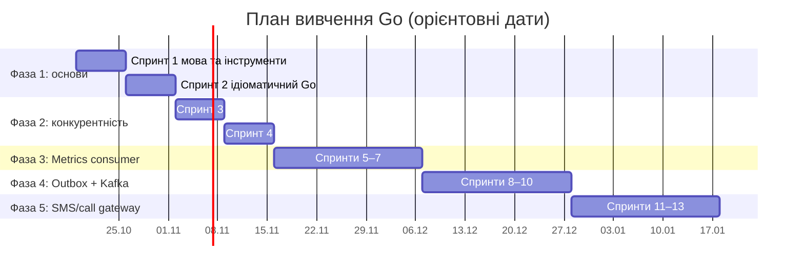

# Go developer diary

Публічний щоденник вивчення Go розробником із C++ (backend, PostgreSQL, high-load).
Записи ведуться українською. Мета: не «пройти курс», а за ~13 тижнів зробити
три проєкти, що повторюють реальні робочі задачі (consumer метрик, outbox + Kafka,
SMS/call gateway), і описати в щоденнику рішення, ADR, порівняння з C++ та діаграми.

Темп: **4–8 годин на тиждень**, база 5–6. Один спринт це один тиждень (понеділок – неділя).
Якщо тиждень зірвався, пропущене не надолужується: воно стає бонусом, а план рухається далі.

## Структура плану

| Фаза | Тема | Тижні | Спринти | Дати | Обсяг |
|---|---|---|---|---|---|
| 1 | Основи Go та ідіоматичний Go | 1–2 | 1–2 | 19.10 – 01.11 | ~10–15 год |
| 2 | Конкурентність | 3–4 | 3–4 | 02.11 – 15.11 | ~10 год |
| 3 | Проєкт 1: Metrics consumer | 5–7 | 5–7 | 16.11 – 06.12 | ~15 год |
| 4 | Проєкт 2: Outbox + Kafka | 8–10 | 8–10 | 07.12 – 27.12 | ~15 год |
| 5 | Проєкт 3: SMS/call gateway workers | 11–13 | 11–13 | 28.12 – 17.01 | ~15 год |

Після фази 5 йдуть проєкти 4–5 (кеш, шардінг, розподілені блокування) разом із другом.
Дати орієнтовні: вони зсуваються, якщо тиждень пропущено.

## Фаза 1. Основи Go (спринти 1–2)

Epic [#1](https://github.com/AlexSol/go-developer-diary/issues/1) і [#2](https://github.com/AlexSol/go-developer-diary/issues/2). Зараз у роботі.

### Спринт 1: мова та інструменти (19.10 – 25.10)
- [ ] [#4](https://github.com/AlexSol/go-developer-diary/issues/4) A Tour of Go, вправи Exercism і конспект відмінностей від C++
- [ ] [#5](https://github.com/AlexSol/go-developer-diary/issues/5) Slices, maps, strings: внутрішня будова й пастки
- [ ] [#6](https://github.com/AlexSol/go-developer-diary/issues/6) Методи, інтерфейси, embedding
- [ ] [#7](https://github.com/AlexSol/go-developer-diary/issues/7) Запис у щоденник №1 і ретро спринту

### Спринт 2: ідіоматичний Go (26.10 – 01.11)
- [ ] [#8](https://github.com/AlexSol/go-developer-diary/issues/8) Помилки: wrapping, `Is`/`As`, sentinel errors
- [ ] [#9](https://github.com/AlexSol/go-developer-diary/issues/9) `defer`, `panic`, `recover` проти RAII
- [ ] [#10](https://github.com/AlexSol/go-developer-diary/issues/10) Тестування: table-driven, benchmarks, coverage, перший CI
- [ ] [#11](https://github.com/AlexSol/go-developer-diary/issues/11) Міні-проєкт: CLI-парсер логів `logstat`
- [ ] [#12](https://github.com/AlexSol/go-developer-diary/issues/12) Лінтери, pprof, щоденник №2 і ретро фази 1

**Мінімум фази:** невеликий CLI з тестами (`logstat`). **Бонус:** `golangci-lint`, перший `pprof`.

## Фаза 2. Конкурентність (спринти 3–4, 02.11 – 15.11)

Заплановано. Issues зʼявляться перед початком фази.

- Теми: goroutines, channels, `select`, `sync`, `context`, `errgroup`, race detector.
- **Мінімум:** worker pool із graceful shutdown.
- **Бонус:** pipeline з backpressure і розбір типових помилок (goroutine leaks, deadlock).
- Спринт 3 (02.11 – 08.11): goroutines, channels, `select`, `sync`.
- Спринт 4 (09.11 – 15.11): `context`, `errgroup`, worker pool, race detector.

## Фаза 3. Проєкт 1: Metrics consumer (спринти 5–7, 16.11 – 06.12)

Заплановано.

- Kafka → ClickHouse: спочатку наївна версія, потім батчинг, offsets, retry/backoff.
- **Мінімум:** працюючий consumer, метрики через Prometheus, `slog`.
- **Бонус:** бенчмарк проти Python-версії, `pprof`, idempotency.
- Спринт 5 (16.11 – 22.11): наївна версія. Спринт 6 (23.11 – 29.11): батчинг, offsets, retry/backoff. Спринт 7 (30.11 – 06.12): метрики, `slog`, бенчмарки.

## Фаза 4. Проєкт 2: Outbox + Kafka (спринти 8–10, 07.12 – 27.12)

Заплановано.

- Transactional outbox на PostgreSQL (`pgx`), продюсер, дедуплікація на консьюмері.
- **Мінімум:** outbox polling і продюсер з інтеграційним тестом (`testcontainers-go`).
- **Бонус:** OpenTelemetry-трейси через Kafka.
- Спринт 8 (07.12 – 13.12): схема outbox і polling. Спринт 9 (14.12 – 20.12): продюсер і дедуплікація. Спринт 10 (21.12 – 27.12): інтеграційні тести й бонуси.

## Фаза 5. Проєкт 3: SMS/call gateway workers (спринти 11–13, 28.12 – 17.01)

Заплановано.

- HTTP-клієнти до провайдерів: таймаути, retry, rate limiting, circuit breaker.
- **Мінімум:** worker pool + черга задач + health-check + Dockerfile.
- **Бонус:** CI, конфігурація, graceful shutdown під навантаженням.
- Спринт 11 (28.12 – 03.01): HTTP-клієнти й retry. Спринт 12 (04.01 – 10.01): worker pool, черга, rate limiting, circuit breaker. Спринт 13 (11.01 – 17.01): health-check, Dockerfile, конфігурація.

Розбиття фаз 2–5 на спринти орієнтовне, воно уточнюється перед кожною фазою за підсумками ретро.

## Контрольні точки

- Кінець тижня 2: пишеш ідіоматичний Go без підказок.
- Кінець тижня 4: можеш написати конкурентну програму без data race.
- Кінець тижня 7: перший Go-сервіс, що замінює Python-консьюмер.
- Кінець тижня 13: три проєкти в щоденнику, готові до публікації.

## Як працює процес

1. **Задачі це GitHub issues.** Епік це issue з sub-issues, спринт це milestone, фаза це label (`phase-1` тощо).
2. Для кожної задачі: `gh issue develop <N> --checkout`, робота в гілці, PR як **Draft**.
3. В описі PR: `Closes #<N>` і чекліст Definition of Done зі шаблону.
4. Коли готово, PR переводиться в **Ready for review**. Його читають два ревʼюери:
   GitHub Copilot (швидкий перший прохід) і агент Claude (DoD, перевірки, питання на розуміння).
5. Після виправлень і ✅ PR мерджиться, issue закривається автоматично.
6. Наприкінці спринту ретро записується коментарем в останній issue спринту.

Деталі налаштування ревʼюерів: [docs/reviewer-setup.md](docs/reviewer-setup.md).

## Структура репозиторію

| Каталог | Призначення |
|---|---|
| `exercises/` | Навчальні вправи фази 1 |
| `docs/` | Конспекти (наприклад, `cpp-vs-go.md`), результати бенчмарків |
| `docs/diary/` | Записи щоденника |
| `cmd/`, `internal/` | Зʼявляться з першої програми (`logstat`, спринт 2) |
| `.github/` | Workflows ревʼюерів, правила ревʼю, шаблон PR |

## Щоденник

Записи зʼявляться тут по мірі виконання плану.

<!-- diary-index -->
