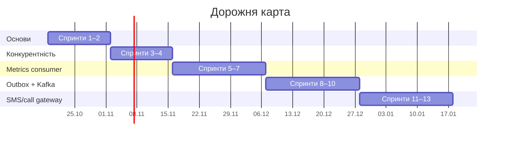

# Go developer diary

> Публічний щоденник переходу з C++ на Go: за 13 тижнів, з трьома реальними проєктами, ADR і діаграмами.

Я бекенд-розробник на C++ (PostgreSQL, high-load, e-commerce) і вивчаю Go на задачах, схожих на ті, що вирішую на роботі.
Тому тут немає курсу «з нуля»: кожен проєкт повторює реальний сервіс, спочатку в наївному вигляді, потім з покращеннями.
Усі рішення, помилки й порівняння з C++ я записую українською, щоб ці нотатки могли стати в пригоді іншим розробникам.

Темп: 4–8 годин на тиждень. Один спринт це один тиждень. Якщо тиждень не склався, я не надолужую його: пропущене стає бонусом, а план іде далі.

## План

| Фаза | Що роблю | Спринти | Дати | Результат |
|---|---|---|---|---|
| **1. Основи Go** | Мова, інтерфейси, помилки, тести, CLI | 1–2 | 19.10 – 01.11 | CLI-утиліта `logstat` з тестами |
| **2. Конкурентність** | Goroutines, channels, `context`, `errgroup` | 3–4 | 02.11 – 15.11 | Worker pool без data race |
| **3. Metrics consumer** | Kafka → ClickHouse | 5–7 | 16.11 – 06.12 | Go-сервіс, що замінює Python-консьюмер |
| **4. Outbox + Kafka** | Transactional outbox на PostgreSQL | 8–10 | 07.12 – 27.12 | Продюсер з інтеграційними тестами |
| **5. SMS/call gateway** | Worker-и, retry, rate limiting | 11–13 | 28.12 – 17.01 | Gateway з health-check і Dockerfile |

Після п'ятої фази заплановано ще два проєкти (кеш, шардінг, розподілені блокування), які я хочу зробити разом із другом.
Дати орієнтовні й зсуваються разом із пропущеними тижнями.

## Фаза 1. Основи Go

Це поточна фаза. Задачі ведуться в [issues](https://github.com/AlexSol/go-developer-diary/issues): два епіки й десять задач, по одному pull request на кожну.

**Спринт 1: мова та інструменти** (19.10 – 25.10), епік [#1](https://github.com/AlexSol/go-developer-diary/issues/1)

- [ ] [#4](https://github.com/AlexSol/go-developer-diary/issues/4) A Tour of Go, вправи Exercism, конспект відмінностей від C++
- [ ] [#5](https://github.com/AlexSol/go-developer-diary/issues/5) Slices, maps, strings: як вони влаштовані й де підводять
- [ ] [#6](https://github.com/AlexSol/go-developer-diary/issues/6) Методи, інтерфейси, embedding
- [ ] [#7](https://github.com/AlexSol/go-developer-diary/issues/7) Перший запис у щоденнику й ретро спринту

**Спринт 2: ідіоматичний Go** (26.10 – 01.11), епік [#2](https://github.com/AlexSol/go-developer-diary/issues/2)

- [ ] [#8](https://github.com/AlexSol/go-developer-diary/issues/8) Помилки: wrapping, `errors.Is` і `errors.As`
- [ ] [#9](https://github.com/AlexSol/go-developer-diary/issues/9) `defer`, `panic` і `recover` проти RAII
- [ ] [#10](https://github.com/AlexSol/go-developer-diary/issues/10) Тестування, бенчмарки, перший CI
- [ ] [#11](https://github.com/AlexSol/go-developer-diary/issues/11) Міні-проєкт: CLI-парсер логів `logstat`
- [ ] [#12](https://github.com/AlexSol/go-developer-diary/issues/12) Лінтери, pprof, другий запис і ретро фази

## Що буде далі

Issues для наступних фаз я створюю перед їх початком, а розбиття на спринти уточнюю за підсумками ретро.

### Фаза 2. Конкурентність (02.11 – 15.11)

Спринт 3 присвячений goroutines, channels, `select` і `sync`. У спринті 4 розбираю `context`, `errgroup`, race detector і збираю worker pool із graceful shutdown.
За бажання додам pipeline з backpressure та розбір типових помилок: goroutine leaks і deadlock.

### Фаза 3. Metrics consumer (16.11 – 06.12)

Перепишу Python-консьюмер метрик на Go: Kafka → ClickHouse. У спринті 5 зроблю наївну версію, у спринті 6 додам батчинг, offsets і retry з backoff, у спринті 7 метрики для Prometheus, `slog` і порівняння з Python-версією.
Бонус: `pprof` та idempotency.

### Фаза 4. Outbox + Kafka (07.12 – 27.12)

Transactional outbox на PostgreSQL (`pgx`). Спринт 8 це схема й polling, спринт 9 продюсер і дедуплікація на консьюмері, спринт 10 інтеграційні тести на `testcontainers-go`.
Бонус: OpenTelemetry-трейси через Kafka.

### Фаза 5. SMS/call gateway (28.12 – 17.01)

Воркери, що ходять до зовнішніх провайдерів. Спринт 11: HTTP-клієнти з таймаутами та retry. Спринт 12: worker pool, черга задач, rate limiting і circuit breaker. Спринт 13: health-check, Dockerfile, конфігурація.
Бонус: CI і graceful shutdown під навантаженням.

## Як я працюю

Кожна задача це GitHub issue. Я створюю гілку командою `gh issue develop <N> --checkout`, відкриваю Draft PR із `Closes #<N>` і заповнюю чекліст Definition of Done.
Коли робота готова, переводжу PR у Ready for review. Його переглядають двоє: GitHub Copilot робить швидкий перший прохід, а агент на базі Claude перевіряє DoD, запускає тести й ставить питання на розуміння. Після виправлень PR мерджиться, а issue закривається автоматично.
Налаштування ревʼюерів описано в [docs/reviewer-setup.md](docs/reviewer-setup.md).

## Структура репозиторію

| Шлях | Що там |
|---|---|
| `exercises/` | Навчальні вправи фази 1 |
| `docs/` | Конспекти (наприклад, `cpp-vs-go.md`) і результати бенчмарків |
| `docs/types/` | Довідник за типами даних Go (починається з `map`) |
| `docs/diary/` | Записи щоденника |
| `cmd/`, `internal/` | Зʼявляться з першою програмою (`logstat`, спринт 2) |
| `.github/` | Workflows ревʼюерів, правила ревʼю, шаблон PR |

## Щоденник

Записів поки немає. Перший очікується наприкінці спринту 1.

<!-- diary-index -->
